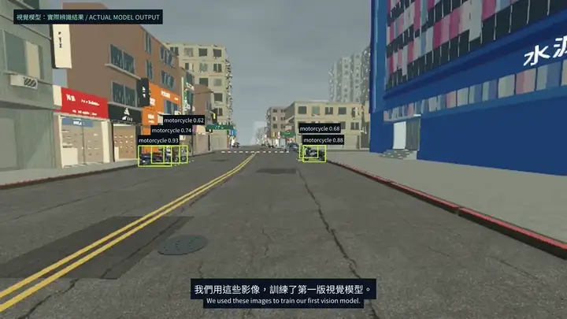
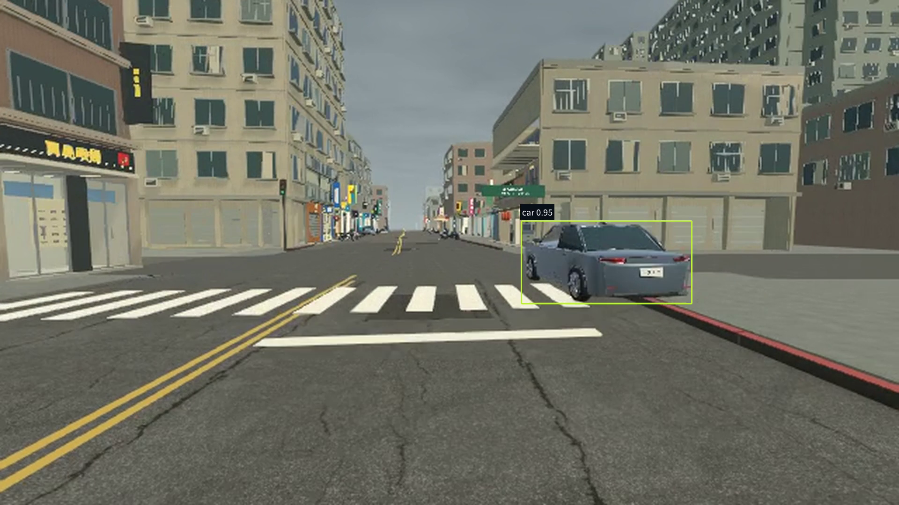
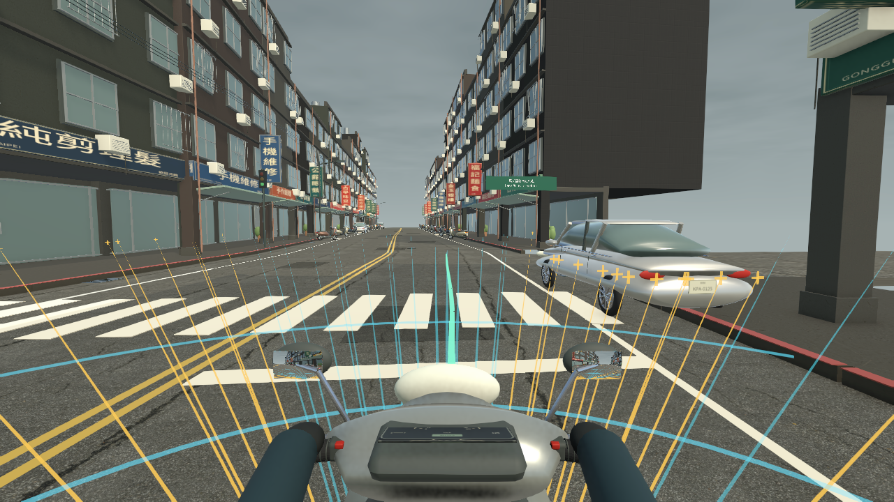

# RideReflex

**Camera and distance-sensing fusion for scooter hazard avoidance.** Proposed entry for the [ASUS UGen AI League](https://contest.bhuntr.com/en/39jg9vimiynrhlksze/home/), **Everyday AI / Battlefield Lightning**.

Our Unity digital-twin prototype recreates **Section 3 of Tingzhou Road in Gongguan, Taipei**, providing synthetic training images and repeatable avoidance tests. Urban scooter riders face sudden cut-ins, crossing traffic and vehicles stopped in their path. RideReflex explores how local perception and distance sensing can help identify these conflicts and support earlier intervention.

We have completed a working pipeline: **generate synthetic training images in Unity → train a car / motorcycle detector → combine its predictions with simulated distance sensing → run the avoidance controller**. Vision currently runs on the host GPU. The next milestone is deployment and measurement on ASUS UGen300.

## Watch the demo

[Watch the 80-second demo — MP4, 720p](Validation/Demo/RideReflex-vision-demo.mp4) · [Chinese voiceover script](docs/DEMO_NARRATION_zh-TW.txt) · [Bilingual subtitles](Validation/Demo/RideReflex-vision-demo.srt)

The video follows **digital twin → trained vision model → Raycast distance sensing → fewer false alarms → dense-fog fallback → UGen300 plans**. It has Chinese / English subtitles, with **no in-game UI or slide screens**. Detection boxes come from actual model outputs. The soundtrack is left open for voiceover.

| Time | What to watch |
|---|---|
| 0:00–0:08 | Gongguan / Tingzhou Road Section 3 digital twin for training and testing |
| 0:08–0:21 | Trained car / motorcycle detector and its actual predictions |
| 0:21–0:39 | Live Raycast beams, distance sensing and rule-based avoidance |
| 0:39–0:52 | Roadside car: simple vision-only warning versus vision + Raycast |
| 0:52–1:07 | Dense fog: visual warning misses the obstacle; fallback avoids it with live Raycast beams shown |
| 1:07–1:20 | Planned UGen300 deployment, measurement and broader data |



The fog comparison uses the same simulated visibility in both runs. The fusion segment displays live Raycast beams; these visualization rays are excluded from the model camera input. Raycast geometry remains available when the model provides no reliable visual evidence. This demonstrates fallback in Unity; real sensor behavior in fog has not been tested.

### Latest screenshots

| Camera perception | First-person avoidance |
|---|---|
|  |  |
| A recorded YOLOv8n prediction on the exact camera input. | Vision + Raycast run, passing a car stopped in the lane. |

Both images are frames from the latest Unity capture. The detection box is added from recorded model output; the first-person image is a clean camera frame.

## What works today

| Component | Implemented |
|---|---|
| Training pipeline | 1,600 labeled synthetic images; 1,200 train / 200 validation / 200 test. YOLOv8n fine-tuned for cars and motorcycles. |
| [Camera perception](Assets/TaiwanRider/Runtime/RiderVisionSensor.cs) | ONNX inference inside Unity Inference Engine, using a dedicated first-person camera and the host GPU. |
| [Distance sensing](Assets/TaiwanRider/Runtime/RadarSensor.cs) | 68 Raycasts simulate surrounding distance sensing; repeated contacts estimate obstacle motion. |
| Sensor association | Model boxes and classes are matched to projected Raycast contacts. Confidence and freshness checks decide whether visual evidence may affect control. |
| [Avoidance](Assets/TaiwanRider/Runtime/AutomaticAvoidance.cs) | A rule-based controller predicts conflicts, brakes for crossing traffic, or steers through an available side before returning to the route. |
| Fallback | Missing, ambiguous, low-confidence or stale visual evidence leaves the Raycast policy available. |

```text
First-person RGB → YOLOv8n → class / confidence / image box
Raycast contacts → distance / motion / bounds
                  ↓ association
       rule-based risk prediction → brake / steering / throttle
```

The sensor casts **44 surrounding rays and 24 forward rays**, reaching up to **32 m ahead, 16 m sideways and 10 m behind**. Consecutive hits estimate relative motion; the controller predicts overlap with obstacle bounds, then checks left / right route offsets for clearance. Crossing traffic triggers braking, and the rider returns to the original route after the conflict passes.

Visual classification can extend the prediction horizon from **1.8 s** to **2.2 s for cars** or **2.4 s for motorcycles**. These are manually configured control rules. The learned model supplies perception; distance, steering and braking use the simulator's geometry and controller.

## Evidence so far

| Check | Result | Scope |
|---|---|---|
| Detection | **84.2% mAP@50** | 200 synthetic test images; the splits share vehicle meshes and street scenery. |
| Closed-loop runs | **9/9 routes completed without a recorded collision** | Four Raycast / fusion pairs and one mid-run vision-disable test, at a 40 km/h cruise target. Each case was run once in the final check. |
| Roadside-car example | **1 unnecessary vision-only warning / 0 fusion interventions** | One controlled pair using a simple image-box warning baseline; both runs passed the roadside car without collision. |
| Dense-fog example | **Visual baseline collided / fusion completed without collision** | One controlled pair with identical fog; fusion intervened using Raycast, without visual confirmation. |
| Capture-to-result latency | **52.9 ms mean / 79.4 ms P95** | 647 inferences on an RTX 3060 Laptop GPU; includes capture, scheduling, execution and readback. |

The roadside car is correctly recognized by both runs; the error is an unnecessary **hazard warning**, not an incorrect object class. During the four seconds after the warning, the image-box baseline slowed to **18.1 km/h**, while fusion stayed at **40.0 km/h**. In a separate in-lane obstacle check, both controllers responded without collision. The vision-only baseline uses manually chosen image thresholds and shares the same route follower; this example does not establish superiority over all camera-only systems.

The comparison uses fixed 30 fps capture and hides other parked-vehicle props identically in both runs to isolate one vehicle. [Baseline rules, setup and capture evidence](docs/VISION_MODEL.md#demo-capture) document the scope. The [fog capture report](Validation/VisionV1/fog-comparison.json) records both runs, visibility settings and the fallback decision. Latency above comes from the separate real-time integration check.

These results describe fixed Unity scenarios. Raycasts are idealized distance sensing with collider bounds, and the controller knows the route. The model does not yet identify drivable space. General road safety, real-camera accuracy and UGen300 performance remain to be evaluated.

[Model, implementation and test details](docs/VISION_MODEL.md) · [Raw integration report](Validation/VisionV1/report.json) · [Numerical parity check](Validation/VisionV1/parity-check.json)

## What UGen300 enables us to test next

| Milestone | Work | Evidence we will collect |
|---|---|---|
| **Deploy the current model** | Calibrate and quantize the two-class detector, compile a Hailo-10H HEF, and connect HailoRT inference to the same Unity controller. | Detection quality before / after quantization and complete scenario runs on the device. |
| **Measure deployment cost** | Compare the GPU and UGen300 using identical inputs and scenarios. | End-to-end mean / P95 latency, throughput, host GPU load, device and whole-system power, and sustained-run stability. |
| **Broaden perception** | Add unseen vehicle assets, roads, lighting and occlusion, followed by real-camera data. Evaluate pedestrian detection and drivable-space segmentation as separate model extensions. | Missed detections, false detections, false braking, clearance and collisions on held-out scenarios. |
| **Build a sensor prototype** | Pair a real camera with physical distance sensing and begin with rider alerts. | Time alignment, distance error, warning timing and usability before considering vehicle actuation. |

ASUS provides a [Windows YOLOv8 / HailoRT demo](https://github.com/Asus-UGen-Series/UGen300-Demo-Package-Windows-User-Guide), and Hailo documents [custom YOLOv8 compilation for Hailo-10H](https://github.com/hailo-ai/hailo_model_zoo/blob/master/training/yolov8/README.rst). These are the deployment starting points; the current ONNX has not been compiled or tested on UGen300. Hardware speed and power improvements will be measured rather than assumed. Generalization work on data and models can continue before the device arrives.

## Run locally

Install **Unity Editor 6000.4.10f1** and Git LFS:

```bash
git clone https://github.com/FlyDragonW/ASUS_AutoDodge.git
cd ASUS_AutoDodge
git lfs pull
```

Open [`Assets/TaiwanRider/Scenes/GongguanRide.unity`](Assets/TaiwanRider/Scenes/GongguanRide.unity) and press **Play**. Select normal riding, car cut-in or crossing scooter. Vision warms up automatically; Raycast control remains available while it is unavailable.

| Key | Action |
|---|---|
| `H` | Toggle vision fusion / Raycast only |
| `F2` | Toggle automatic control |
| `V` | Switch first / third person |
| `G` | Show / hide sensor rays |

The repository contains the Unity source project. See [Vision v1](docs/VISION_MODEL.md#reproduce-the-integration-check) for the automated check, including the parked-car scenario.

Asset attribution: [source manifest](Sources/asset-manifest.json) · [third-party notices](Sources/THIRD_PARTY_NOTICES.txt).
