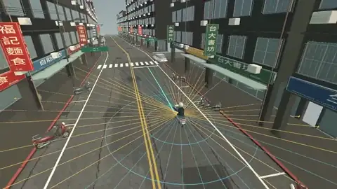
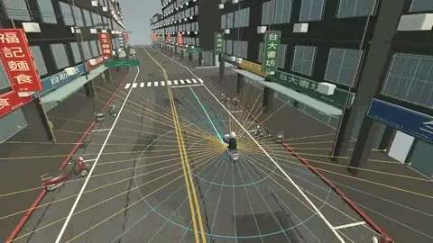

# RideReflex

**A scooter hazard-avoidance prototype for urban traffic.** Proposed entry for the [ASUS UGen AI League](https://contest.bhuntr.com/en/39jg9vimiynrhlksze/home/) in **Everyday AI / Battlefield Lightning**.

The current Unity demo uses Raycast sensing and a rule-based controller to avoid a car cut-in or yield to a crossing scooter. The next stage will add camera perception on ASUS UGen300 and test whether it handles more varied situations. **No machine-learning model or UGen300 inference is implemented yet.**

## Demo

[Full 14-second demo (MP4, 540p, 3 MB)](Validation/Demo/RideReflex-demo.mp4) - car cut-in, then crossing scooter, at a 40 km/h cruise target.

The video and animated previews are direct Unity camera captures with **no in-game UI**. Colored rays show the simulated sensor.



**Car cut-in:** detect the conflict, steer left through available space, then return to the lane.



**Crossing scooter:** detect lateral movement, brake to yield, then resume cruising.

## What is implemented

The [Unity 6 scene](Assets/TaiwanRider/Scenes/GongguanRide.unity) models a Gongguan-inspired road with two scripted hazards. Its rule-based control loop runs each physics update:

1. **Sense:** [RadarSensor.cs](Assets/TaiwanRider/Runtime/RadarSensor.cs) casts 68 `Physics.Raycast` rays: 44 around the scooter and 24 concentrated ahead. They reach up to 32 m forward, 16 m sideways, and 10 m behind.
2. **Track and predict:** Consecutive hits on the same collider estimate its velocity. [AutomaticAvoidance.cs](Assets/TaiwanRider/Runtime/AutomaticAvoidance.cs) compares that motion with the scooter's velocity and collider bounds to identify possible intersections within about 1.8 seconds.
3. **Choose a response:** Fast lateral crossings trigger braking. For other conflicts, the controller checks whether the left or right route offset is clear; it steers around the obstacle if possible, or makes an emergency stop if both sides are blocked.
4. **Act and recover:** A look-ahead point on the known route sets steering, while speed control sets throttle and brake. After the hazard passes, the scooter gradually returns to its original lane.

The [validation report](Validation/RadarControls/acceptance.json) records **32/32 passing checks**. At both 40 and 50 km/h, the scripted car cut-in triggered an evasive maneuver and the crossing scooter triggered braking; all four runs reached the finish without a recorded collision. A clear-road run recorded no unnecessary intervention. These results apply only to the scripted Unity scenarios.

## Planned edge AI extension

```text
Unity camera → compact vision model on ASUS UGen300 → road-user / drivable-space cues
             → motion and risk tracking on host → rule-based safety layer → scooter
```

Vision is intended to add road-user and drivable-space cues that geometric rays alone do not provide. We plan to vary traffic timing, road layout, lighting, and viewpoint in the simulator; use its scene data to label training images; and reserve unseen combinations for evaluation. The [UGen300](https://press.asus.com/news/press-releases/asus-ugen300-usb-ai-accelerator-generative-ai-edge/) would run local perception, while the existing controller remains a transparent baseline and fallback. We will compare rules-only and vision-assisted runs using collision rate, minimum clearance, false braking, intervention time, and measured inference latency and power on the hardware.

The first practical use is a repeatable testbed for scooter rider-assistance research. The Raycasts approximate distance sensing; they are **not physical radar**. Any on-vehicle system would require real sensors and independent safety validation.

## Run locally

Install **Unity Editor 6000.4.10f1** and Git LFS, then clone the project:

```bash
git clone https://github.com/FlyDragonW/ASUS_AutoDodge.git
cd ASUS_AutoDodge
git lfs pull
```

Open [`Assets/TaiwanRider/Scenes/GongguanRide.unity`](Assets/TaiwanRider/Scenes/GongguanRide.unity) in Unity and press **Play**. Choose normal riding, car cut-in, or crossing scooter in the menu. Press `F2` to toggle automatic control, `V` to switch camera, and `G` to show or hide rays. The repository contains the Unity source project, not a packaged player.

Asset attribution: [source manifest](Sources/asset-manifest.json) · [third-party notices](Sources/THIRD_PARTY_NOTICES.txt).
